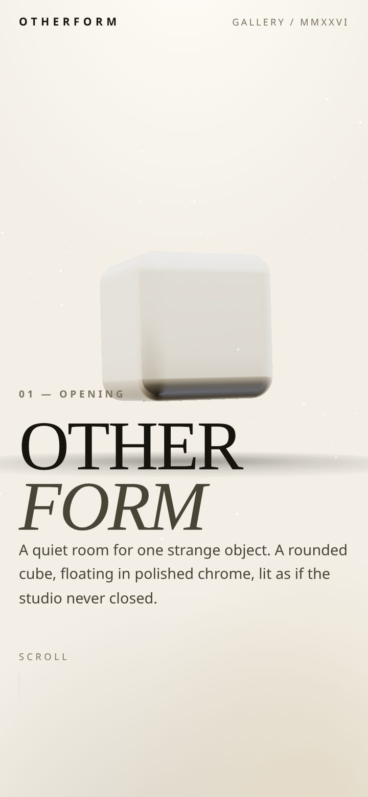
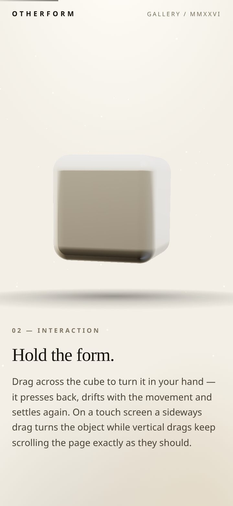
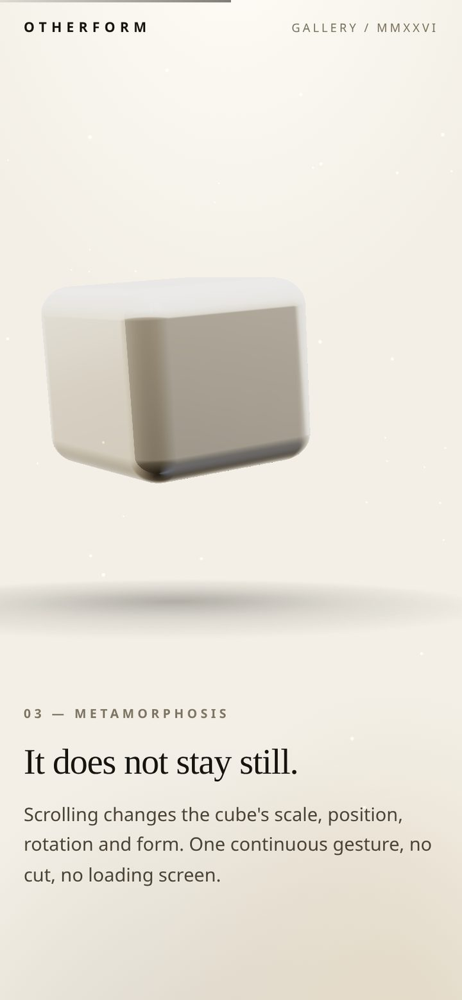
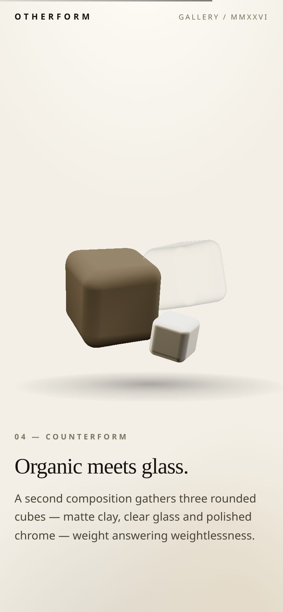
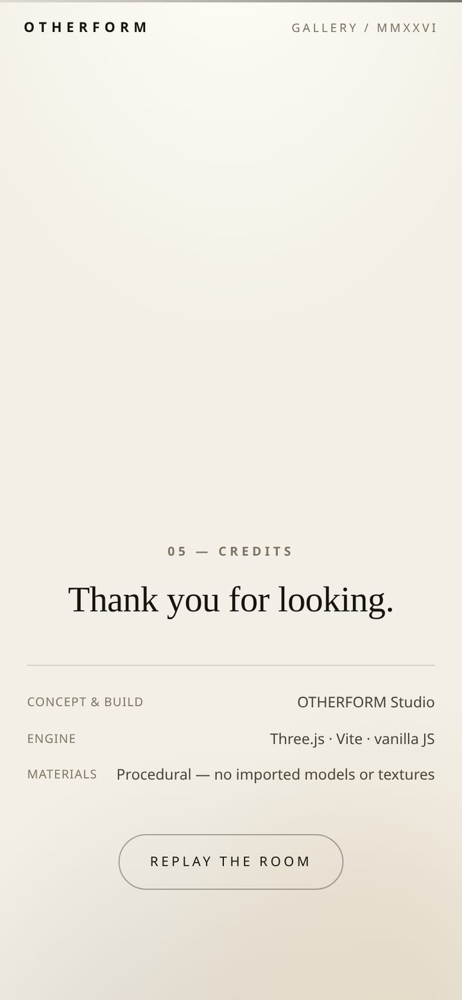
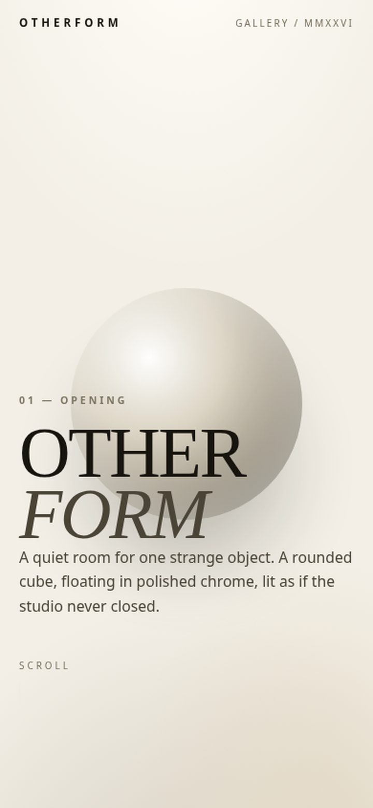

# OTHERFORM

An ultra-light surreal 3D gallery. One fixed WebGL stage, a floating rounded
cube you can push around, a warm ivory room — and an initial network transfer
of about **122 KB gzipped**, roughly an eighth of the 1,000 KB budget.

Built with Vite, vanilla JavaScript and Three.js. No React, no GSAP, no UI
framework, no imported 3D models, no textures, no remote fonts, no
third-party requests at all. Every material, every environment map and every
sprite is generated procedurally at runtime.

---

## Quick start

```bash
npm install
npm run dev        # development server with HMR
npm run build      # production build into dist/
npm run preview    # serve the production build locally
```

Requires Node 20 or newer.

### Deploying

`npm run build` emits a fully static `dist/` folder. Because
`base: "./"` is set in `vite.config.js`, the output uses relative asset URLs
and can be dropped at a domain root or in any sub-path.

- **Netlify / Vercel / Cloudflare Pages** — build command `npm run build`,
  publish directory `dist`.
- **GitHub Pages** — push the contents of `dist/` to the `gh-pages` branch
  (or a `docs/` folder). No extra base path is needed.
- **Any static host / S3 / nginx** — upload `dist/`.

Serve the assets with gzip or brotli enabled; both are assumed in the size
report.

---

## The experience

Five chapters, driven by one continuous scroll:

| # | Chapter | What happens |
|---|---------|--------------|
| 01 | Opening | A single rounded, polished-chrome cube floating in the room |
| 02 | Interaction | The cube turns with a horizontal drag, presses back under your finger, drifts with the movement and springs home |
| 03 | Metamorphosis | Scroll changes the cube's scale, position, rotation and form (a slow non-uniform stretch) |
| 04 | Counterform | Second composition: three rounded cubes — matte clay, clear glass, polished chrome |
| 05 | Credits | Minimal close with a replay control that returns you to the opening |

The 3D stage is a single fixed `<canvas>` behind the content, so there is one
renderer, one scene and one animation loop for the whole page. Chapters are
staged by mapping scroll progress (0 → 1) onto keyframed transforms rather
than swapping scenes.

## Screenshots

Mobile portrait, 390×844. Captured from the production build — rendered with a
software rasteriser in headless Chrome, so read them as composition references
rather than a performance claim.

| | | |
|---|---|---|
|  |  |  |
| 01 Opening | 02 Interaction | 03 Metamorphosis |
|  |  |  |
| 04 Counterform | 05 Credits | No-WebGL fallback |

## Visual direction

- Warm ivory gallery background, painted in CSS (a light gradient plus a
  low vignette) — no background texture is downloaded.
- A floating rounded cube in polished chrome; translucent glass and matte,
  noise-displaced clay solids in the second composition.
- Procedural studio environment: a 512×256 equirectangular canvas with a
  hard horizon and two strip lights, baked once through `PMREMGenerator`
  and used for all reflections. No HDR file, no real-time reflection pass.
- Editorial typography — an oversized serif display face with small,
  letter-spaced sans labels — set in system font stacks so no webfont is
  fetched.
- A single soft contact shadow per composition and a sparse dust field.
  No post-processing.

## Project structure

```
otherform/
├─ index.html               markup + chapter copy
├─ vite.config.js           production build config
├─ package.json
├─ src/
│  ├─ main.js               DOM behaviour: reveal, progress rail, boot
│  ├─ styles.css            gallery styling, mobile-first
│  └─ three/
│     ├─ app.js             renderer, scene, camera, staging, input, loop
│     ├─ sculpture.js       the two compositions + geometry LODs
│     ├─ materials.js       chrome / glass / organic materials
│     ├─ shaders.js         simplex noise, displacement + fresnel injection
│     ├─ env.js             procedural studio environment map
│     ├─ textures.js        procedural shadow + dust sprites
│     └─ quality.js         adaptive quality tiers
├─ dist/                    production build output
└─ SIZE_REPORT.md           measured sizes, timings and caveats
```

## The object

The primary object is a single **rounded cube** built with
`RoundedBoxGeometry` — procedurally generated, no imported model. It floats on
a slow bob, turns continuously, and responds to the pointer in three ways at
once:

- **turn** — a horizontal drag spins it (with a touch screen, vertical drags
  still scroll the page);
- **move** — the same drag nudges it sideways and vertically, and it springs
  back home when you let go;
- **react** — holding squashes it along the vertical axis, releasing gives a
  small overshoot, and the chrome brightens slightly while it is being handled.

The second composition gathers three smaller rounded cubes — matte clay,
clear glass and polished chrome — as a contrast to the single hero object.

## How the rendering stays cheap

**Custom shaders, zero extra passes.** Organic forms and glass edges are
custom shader code injected into `MeshStandardMaterial` /
`MeshPhysicalMaterial` with `onBeforeCompile`. That keeps the PBR pipeline
and its environment reflections while adding layered simplex-noise
displacement (with normals rebuilt from finite differences) and a fresnel
alpha term for the glass. No second shader system, no transmission render
target.

**Reflections without a reflection pass.** Reflections come from a single
PMREM-baked environment map generated from a canvas, not from real-time
cube cameras.

**Geometry LODs.** Every rounded cube keeps three pre-built LODs (300 / 1,452 /
3,468 triangles), so a quality change swaps a `BufferGeometry` reference
instead of allocating mid-frame.

**Adaptive quality.** `quality.js` watches a smoothed frame time and moves
between three tiers:

| Tier | Pixel ratio cap | Cube subdivision | Dust |
|------|-----------------|------------------|------|
| 0 low | 1.0 | 300 triangles | off |
| 1 balanced | 1.5 | 1,452 triangles | on |
| 2 high | 2.0 | 3,468 triangles | on |

It steps down if the smoothed frame time stays above ~26 ms and steps up
only when it is comfortably under ~13.5 ms, with a cooldown and a cap on
upgrades so it cannot oscillate. The starting tier is chosen from pointer
type, `hardwareConcurrency` and `deviceMemory`, starting conservatively on
mobile.

A manual override is available for demos, kiosks and screenshot capture:
append `?tier=0`, `?tier=1` or `?tier=2` to the URL. When present, adaptation
is disabled and that tier is pinned.

**Other budget guards.** Antialiasing is enabled only on fine-pointer
devices; the module-preload polyfill is dropped; there are no images, fonts
or third-party scripts; and rendering is paused entirely while the tab is
hidden.

## Accessibility and responsiveness

- Mobile portrait first; tablets and desktop are handled without breaking the
  composition (text re-centres, the camera fits the sculpture to the viewport
  aspect).
- The canvas is `aria-hidden`; all copy is real HTML text.
- Touch feedback is direct manipulation: press squashes the cube, a drag also
  nudges it, and it springs back when released. Under
  `prefers-reduced-motion` the ambient drift stops but this feedback stays
  (at half strength), because it is a response to the visitor's own action.
- `touch-action: pan-y` on the canvas means vertical touch scrolling is never
  intercepted — only horizontal drags rotate the object.
- `prefers-reduced-motion: reduce` disables the idle drift, the intro fade and
  the CSS reveal transitions, and makes transforms snap instead of easing.
- Keyboard users get native scrolling and a focus-visible replay button.
- If WebGL is unavailable, the scene is skipped entirely and a static
  CSS-rendered sculpture is shown; the copy remains fully readable.
- No blocking intro: the page paints its text immediately and the canvas
  fades in when the first frame is ready.

## Measured results

See [SIZE_REPORT.md](./SIZE_REPORT.md) for the full measurements, the method
used, and the caveats — including the fact that the frame-rate figures were
taken in a software-rendered headless browser and are **not** representative
of real-device performance.
